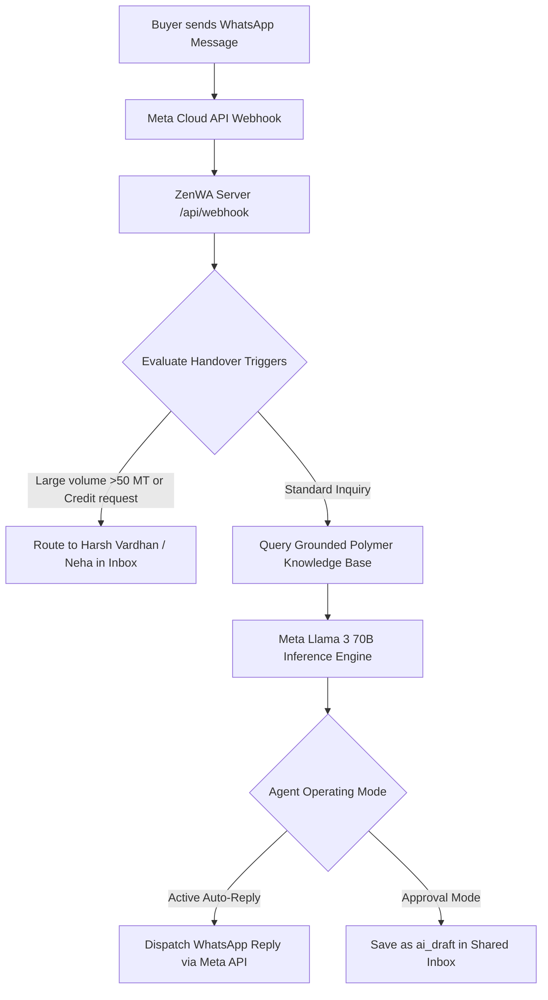

# 🤖 AI Agent Studio (Autonomous WhatsApp Copilot) Setup Guide
**ZENVISTA POLYMERS (Shivam Organics) — Meta Llama 3 & GPT-4o Integration**

---

## 🌟 What is AI Agent Studio?
The **AI Agent Studio** powers an autonomous 24/7 technical polymer sales copilot for Zenvista Polymers. It handles incoming inquiries from buyers on WhatsApp, quotes verified spot prices based on live inventory sheets, explains technical specs (Melt Flow Index, Density, Tensile strength), and drafts proforma quotes in polite Hinglish or English.

### Operating Modes:
1. **Active (24/7 Auto-Replying):** AI immediately responds to buyers in real-time (avg latency: 2.8s).
2. **Draft Mode (Team Approval):** AI drafts responses and displays them in the **Shared Inbox** (`/inbox`) with a 1-click **Approve & Send** button for Harsh Vardhan or Neha Sharma.
3. **Paused:** AI is deactivated; only human agents reply.

---

## 🏗️ AI Copilot Architecture



---

## 🚀 Step-by-Step AI Setup

### Step 1: LLM Provider Configuration in `backend/.env`
ZenWA supports Meta Llama 3 (via Groq / Meta Cloud) or OpenAI GPT-4o:

```env
# AI Studio Configuration
AI_STUDIO_PROVIDER=MetaLlama3
AI_STUDIO_API_KEY=gsk_your_groq_or_openai_api_key_here
AI_STUDIO_MODEL=llama-3-70b-instruct
```

> [!TIP]
> Groq provides sub-second (<500ms) latency for Llama 3 70B, which feels instantaneous to WhatsApp users.

### Step 2: System Persona & Instruction Prompt
Configure the AI's core instructions in `http://localhost:3000/ai-agent`:

```text
You are the official WhatsApp Sales & Technical Assistant for ZENVISTA POLYMERS (Shivam Organics), managed by Harsh Vardhan.
Your job is to assist plastic manufacturers, injection molders, blow molders, and packaging units with verified polymer granule rates, technical datasheets (TDS), sample requests, and order dispatch terms.

Pricing & Grade Rules:
1. HDPE Blow Molding Grade B56003 is priced at ₹118/kg Ex-Kandla.
2. PP Homopolymer Injection Grade H110MA is priced at ₹104/kg FOT Ahmedabad.
3. LLDPE Film Grade 010F18A is priced at ₹112/kg Ex-Mundra.
4. PVC Resin Suspension K-67 is priced at ₹89/kg + GST.

Operational Rules:
- Minimum Order Quantity (MOQ) is 1,000 kg (1 Metric Ton).
- Payment terms are 100% Advance RTGS or 15-day PDC for verified GST accounts.
- If a client requests >50 MT or asks for >₹2/kg discount, tag the conversation for immediate handover to Harsh Vardhan or Neha Sharma.
- Speak in professional, polite Hinglish or English.
```

### Step 3: Grounded Knowledge Base Management
The AI is strictly constrained to the products stored in `AIAgentConfig.knowledgeBase`:
- **HDPE B56003:** Melt Flow Index: `0.35 g/10min`, Density: `0.958 g/cc`, Rate: `₹118/kg`
- **PP H110MA:** Melt Flow Index: `11.0 g/10min`, Density: `0.905 g/cc`, Rate: `₹104/kg`
- **LLDPE 010F18A:** Melt Flow Index: `1.0 g/10min`, Density: `0.918 g/cc`, Rate: `₹112/kg`
- **PVC K-67:** K-Value: `67`, Density: `1.40 g/cc`, Rate: `₹89/kg`

Whenever daily rates fluctuate, updating them in the AI Studio instantly updates the AI's quotations across all chats.

### Step 4: Autonomous Handover Rules
ZenWA features built-in safety triggers that prevent the AI from making unauthorized commercial commitments:
1. **Bulk Volume Trigger:** If requested quantity > 50 MT, the AI flags the chat for Harsh Vardhan.
2. **Credit Terms Trigger:** If buyer requests 30-day or 60-day credit, the AI tags Neha Sharma and responds that credit lines require GST balance sheet verification.
3. **Quality Dispute:** If words like "damaged", "contamination", or "rejection" appear, the AI alerts management immediately.

---

## 🧪 Testing with the Built-in Simulator
You can test the AI's responses directly in the browser at `http://localhost:3000/ai-agent`:
1. Use the pre-built prompt chips:
   - `💬 HDPE 20 MT Rate`: Tests standard spot quote generation with MOQ and delivery ports.
   - `💬 PP H110MA TDS`: Tests technical datasheet citations.
   - `⚠️ Test Handover Trigger`: Tests credit request detection and handover alerts.
2. Type any custom message in Hindi, English, or Gujarati to verify response accuracy and tone.
