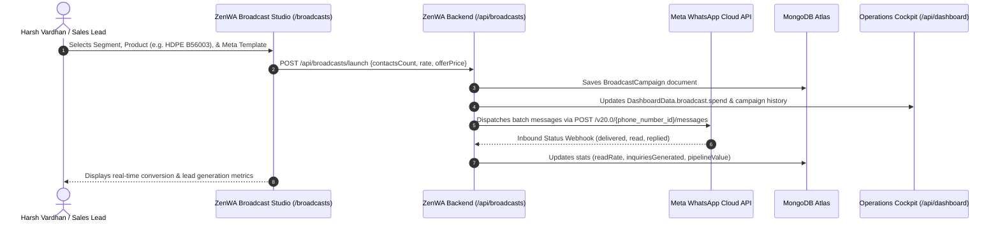

# 📢 WhatsApp Bulk Broadcast Studio Setup & Integration Guide
**ZENVISTA POLYMERS (Shivam Organics) — Meta Cloud API Bulk Engine**

---

## 🌟 What is the WhatsApp Broadcast Studio?
The **ZenWA Broadcast Studio** enables Zenvista Polymers to launch targeted promotional campaigns, spot price alerts, and inventory clearance announcements to thousands of verified polymer buyers simultaneously, without risking phone number bans or rate limits.

### Key Highlights:
- **Meta WABA Tier 3 Limit:** Up to 100,000 unique business-initiated messages per 24 hours.
- **Dynamic Pricing Controls:** Configurable price-per-message (Marketing: ₹0.86/msg; Utility: ₹0.40/msg) with instant budget calculations.
- **Audience Segmentation:** Filter dispatches by polymer manufacturing application (HDPE Blow Molding, PP Injection, PVC Extrusion, Masterbatch Units).
- **Cross-Module Sync:** Launching a campaign automatically logs the spend and ROI in the **Operations Cockpit** (`DashboardData`) and logs direct buyer inquiries in the **Shared Inbox**.

---

## 🏗️ Architecture & Dispatch Lifecycle



---

## 🚀 Step-by-Step Meta Broadcast Setup

### Step 1: Create Approved WhatsApp Message Templates
Meta requires all business-initiated bulk messages to use pre-approved Message Templates.

1. Go to [Meta Business Manager](https://business.facebook.com/) > **WhatsApp Accounts** > Select your WABA.
2. Click **Message Templates** > **Create Template**:
   - **Category:** `MARKETING`
   - **Name:** `zenvista_polymer_bulk_offer`
   - **Language:** English (`en_US`) or Hindi/Hinglish
3. **Template Body:**
   ```text
   🔥 Special Spot Offer from ZENVISTA POLYMERS:
   Premium {{1}} (Grade {{2}}) is now available for bulk dispatch at ₹{{3}}/kg Ex-Kandla Port.
   
   • Minimum Order: {{4}} Metric Tons
   • Ready Stock with Test Certificate & COA.
   
   Reply 1 for Immediate Proforma Invoice or 2 to request 5kg testing sample granules.
   ```
4. **Variables Sample Values:**
   - `{{1}}`: HDPE Blow Molding Grade
   - `{{2}}`: B56003
   - `{{3}}`: 118
   - `{{4}}`: 5
5. Submit for Review (Meta typically approves polymer marketing templates in 2–15 minutes).

### Step 2: Meta Utility Template (Lower Cost: ₹0.40/msg)
For non-promotional alerts (sample dispatch tracking, proforma invoices, order receipts):
- **Category:** `UTILITY`
- **Name:** `sample_dispatch_alert`
- **Body:**
  ```text
  🚚 Dear {{1}}, your 5kg testing sample for {{2}} has been dispatched via {{3}} (Tracking AWB: {{4}}). Expected delivery in 48 hours.
  ```

### Step 3: Audience Tagging & Segmenting in CRM
Before launching, ensure contacts are categorized in the **Contacts CRM** (`/contacts`):
- `HDPE Blow Molders`: Jerrycan, bottle, and drum manufacturers.
- `PP Injection Molding`: Furniture, household, and industrial caps manufacturers.
- `PVC Pipe Extruders`: Rigid agricultural and casing pipe extruders.
- `Masterbatch Compounders`: Additive and filler compounding plants.

### Step 4: Launching a Campaign in ZenWA
1. Open `http://localhost:3000/broadcasts`.
2. Click **+ Launch Broadcast**.
3. Choose your campaign parameters:
   - Campaign Name: `Diwali Kandla Spot Discount`
   - Target Segment: `HDPE Blow Molders`
   - Product: `HDPE Blow Molding Grade B56003`
   - Contacts: `1,450`
   - Rate: `₹0.86/msg`
4. The system calculates the estimated Meta cost (`₹1,247`).
5. Click **Dispatch Broadcast Now 🚀**.

---

## 📊 Live Webhook Status Tracking
When Meta delivers messages, it posts webhook events to `/api/webhook`:
- `sent`: Message has left the Meta Cloud server.
- `delivered`: Message has reached the buyer's smartphone.
- `read`: Buyer opened the message (two blue ticks).
- `replied`: Buyer answered the WhatsApp template (automatically routed to Neha Sharma / Harsh Vardhan in `/inbox`).
